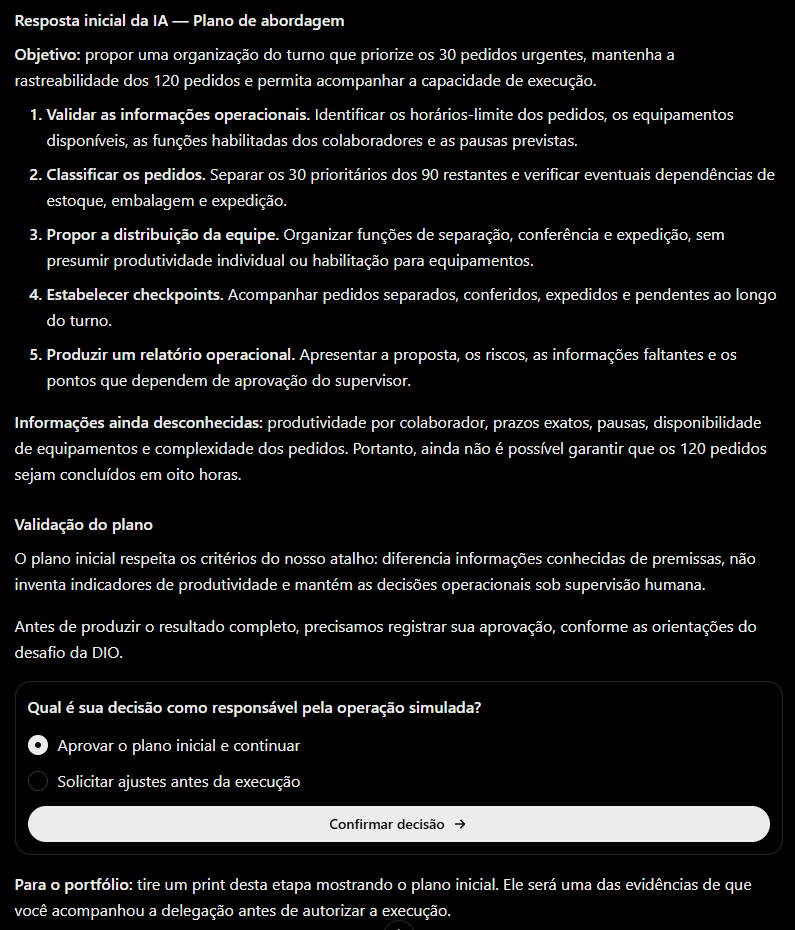
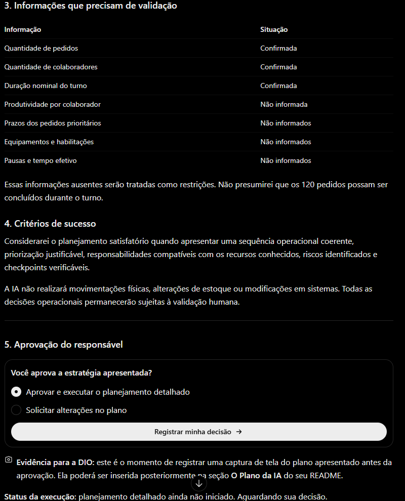
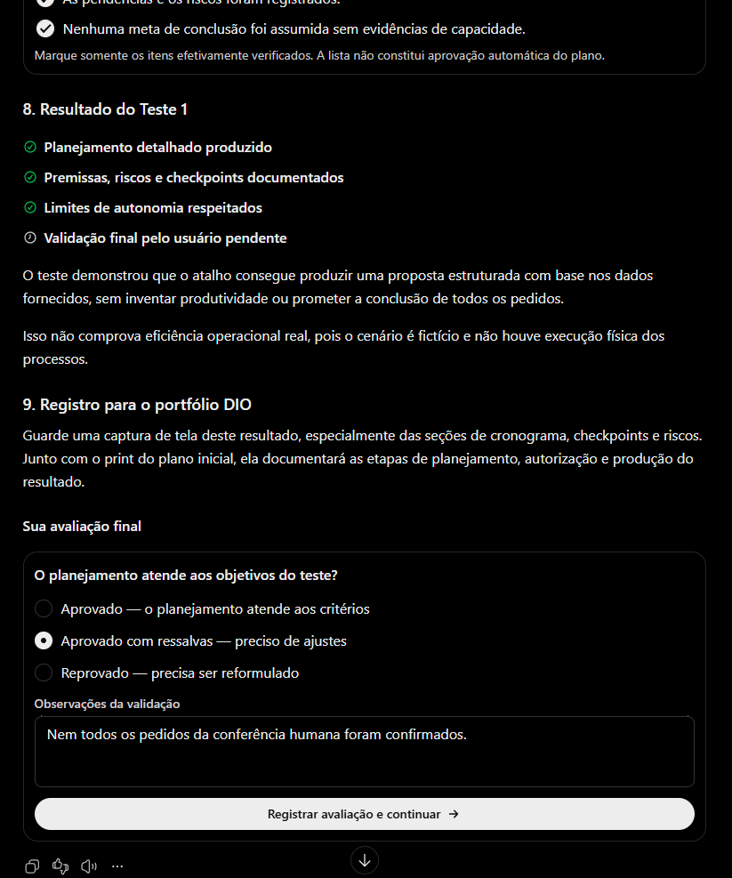
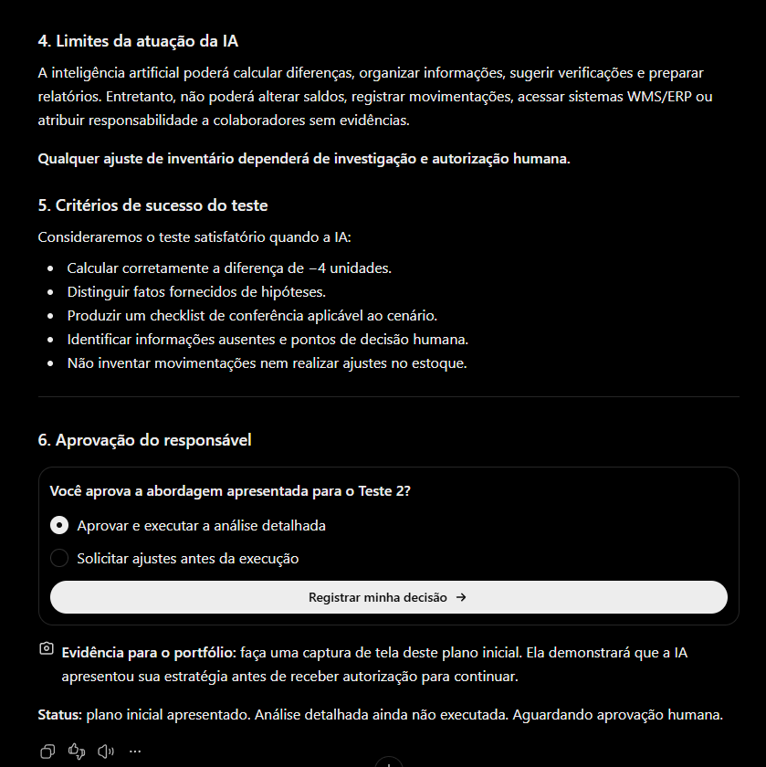
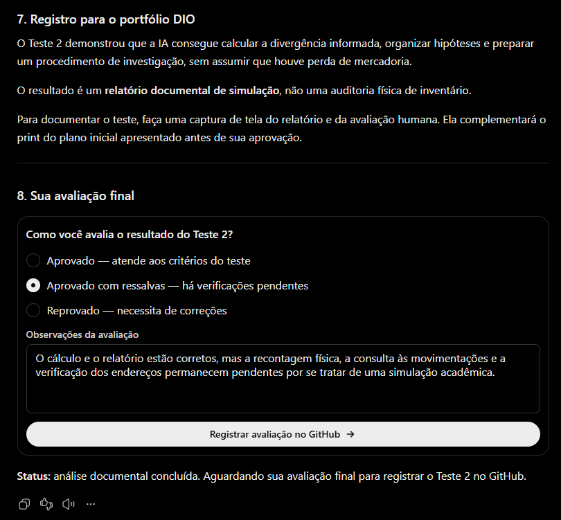

# Meu Kit de IA

Desafio de Projeto da [DIO](https://dio.me): monte o seu kit de IA para o dia a dia e delegue uma tarefa real, com você no comando.

O kit foi criado pelo Expert Bruno Lima com os prompts, templates, checklists e skills usados nas Aulas. Ele não é uma apostila: abra a pasta que resolve o seu problema, copie o modelo, adapte e use.

**Copie → adapte → teste → confira → melhore**

## Como Fazer o Desafio

Você não precisa instalar nada nem saber programar. Tudo acontece no navegador.

1. Clique em **Use this template**, depois em **Create a new repository**. Dê um nome simples, como `meu-kit-de-ia`, deixe **Public** e confirme.
2. Siga os passos abaixo com uma tarefa real da sua semana.
3. Preencha a seção [Minha Entrega](#minha-entrega) da sua cópia e entregue o link dela na DIO.

## Os Passos

1. **Escolha uma tarefa real.** Comece pelo trabalho que se repete na sua semana, como preparar uma reunião ou montar um relatório, e não pela ferramenta.
2. **Pegue um modelo.** Abra a pasta do kit que combina com a sua tarefa. Cada modelo tem um botão de copiar no canto.
3. **Adapte.** Troque o que está entre colchetes pelo seu contexto, objetivo, dados, limites e formato.
4. **Teste.** A primeira resposta é um ponto de partida. Ajuste até funcionar para a sua realidade.
5. **Delegue.** Com o [template de delegação](02-templates/03-delegacao.md), entregue a tarefa à IA. Peça o plano antes de ela começar, acompanhe e valide o resultado.
6. **Confira.** Provável não é o mesmo que verdadeiro. Revise com o [Pare, Confira, Use](03-checklists/01-pare-confira-use.md) antes de usar.

## O Que Tem no Kit

| Pasta | Para que serve |
|---|---|
| [01-prompts](01-prompts) | Pedidos prontos para adaptar: escrita, comunicação, pesquisa, comparação e preparação de reuniões |
| [02-templates](02-templates) | Estruturas para preencher: bom pedido, pesquisa e decisão, e delegação |
| [03-checklists](03-checklists) | Revisão de respostas, de textos e de tarefas delegadas |
| [04-skills](04-skills) | Como criar uma skill, e a Skill Preparador de Reuniões usada nas Aulas |
| [05-delegacao-e-automacao](05-delegacao-e-automacao) | Gatilhos de automação, supervisão e checkpoints |

## Os Frameworks das Aulas

- **Bom pedido:** contexto + instrução + objetivo + formato. Quanto menos a IA precisa adivinhar, melhor você consegue avaliar a resposta.
- **Pesquisa e decisão:** pergunta → pesquisa → critérios → comparação → você. Peça fontes quando precisar de informação externa. A decisão final é sua.
- **Segurança:** pare → confira → use. Valide fatos, números, datas, fontes e contexto.
- **Atalhos reutilizáveis:** criar → testar → ajustar → salvar. Separe as instruções fixas das informações que mudam a cada uso.
- **Delegação:** objetivo + contexto + recursos + limites + sucesso. Autonomia funciona melhor quando o resultado esperado está claro.
- **Supervisão:** definir → delegar → acompanhar → validar. Em tarefas maiores, confira o plano, acompanhe os checkpoints e valide o resultado.

> A IA pode ajudar você a escrever, pesquisar, organizar e executar. A responsabilidade pelo resultado continua sendo sua.

---

## Minha Entrega

Este projeto aplica inteligência artificial ao planejamento de operações de armazém e à conferência de estoque. **Os Testes 1 e 2 são simulações acadêmicas**, sem execução física. A **Etapa 3 é uma aplicação doméstica real**, cuja contagem física foi realizada e declarada pelo participante, com análise documental pela IA. Não houve integração com sistemas de gestão ou alteração automatizada de saldos.

### Tarefa escolhida e natureza da aplicação

Escolhi o planejamento de um turno de um centro de distribuição como **exercício acadêmico de delegação**, com priorização de pedidos, distribuição de funções, identificação de riscos e checkpoints. O segundo exercício aborda a análise documental de divergência de estoque. **Ambos utilizam dados fictícios** e não constituem execução física. Para complementar o requisito de tarefa real, o participante realizou uma **conferência doméstica inicial de cinco categorias de produtos**, documentada na seção **Etapa 3 — Aplicação real** abaixo. A execução física é declarada pelo participante; a IA apenas estruturou e analisou o relatório.

### Meus Atalhos

Adaptei e publiquei dois prompts reutilizáveis na pasta `01-prompts`:

**Atalho 1 — Planejamento de Operações Logísticas:** [abrir prompt completo](01-prompts/06-planejamento-operacional-armazem.md). Mantém fixas as regras de segurança, a separação entre fatos e hipóteses e a exigência de aprovação humana. Variam o volume de pedidos, a equipe, os prazos, os equipamentos e a duração do turno. **Situação:** testado; aprovado com ressalvas.

```text
Atue como assistente de planejamento de armazém.
Com base nos pedidos, prioridades, equipe, jornada e recursos informados,
apresente primeiro sua abordagem e aguarde aprovação.
Depois, proponha prioridades, distribuição por função, checkpoints e riscos.
Separe fatos, premissas e recomendações. Não invente produtividade,
não garanta prazos sem dados e não autorize operações inseguras.
```

**Atalho 2 — Conferência e Controle de Estoque:** [abrir prompt completo](01-prompts/07-conferencia-controle-estoque.md). Mantém fixos o cálculo da divergência, a investigação de hipóteses e a proibição de ajustes automáticos. Variam SKU, saldos, localização e movimentações. **Situação:** testado; aprovado com ressalvas. O prompt completo agora exige aprovação do plano antes da análise detalhada.

```text
Atue como assistente de conferência de estoque.
Para cada SKU, compare a contagem física com o saldo do sistema.
Calcule a diferença (físico - sistema), identifique hipóteses não confirmadas
e proponha um checklist de recontagem e investigação.
Não invente movimentações, não atribua culpa e não ajuste o estoque.
Antes da análise detalhada, apresente o plano e aguarde aprovação.
```

### Minha Delegação

A solicitação abaixo foi efetivamente encaminhada à IA no Teste 1:

```text
OBJETIVO
Elaborar um plano de abordagem e, após aprovação, um planejamento
operacional detalhado para um turno fictício de centro de distribuição.

CONTEXTO
120 pedidos pendentes, 30 prioritários, 6 colaboradores e turno de 8 horas.

RECURSOS
Somente os dados fornecidos na conversa e o atalho de planejamento.

LIMITES
Não presumir produtividade, prazos, habilitações ou disponibilidade
de equipamentos. Não realizar operações físicas nem alterar sistemas.
Diferenciar dados conhecidos, hipóteses e recomendações.

SUCESSO
Entregar um plano coerente com prioridades, responsabilidades propostas,
riscos, checkpoints e critérios de validação humana.

Antes de começar, apresente o plano de abordagem e aguarde minha aprovação.
```

**Delegação do Teste 2 — Conferência e Controle de Estoque:**

```text
OBJETIVO
Analisar documentalmente uma divergência fictícia de estoque e preparar
hipóteses, checklist de verificação, pendências e relatório.

CONTEXTO
SKU CX-101; endereço A-03; saldo do sistema informado: 80 unidades;
contagem física informada: 76 unidades; movimentações desconhecidas.

RECURSOS
Somente os dados fictícios fornecidos e o Atalho 2.

LIMITES
Não inventar movimentações ou causas; não atribuir responsabilidades;
não acessar WMS/ERP; não executar recontagem nem ajustar saldos.

SUCESSO
Calcular corretamente a divergência; separar fatos de hipóteses;
produzir checklist, pendências e relatório sujeito a validação humana.

Antes de produzir a análise detalhada, apresente o plano de abordagem
e aguarde minha aprovação.
```

### O Plano da IA

A IA apresentou uma abordagem com cinco etapas: analisar pedidos e prioridades; verificar capacidade operacional; propor distribuição de funções; estabelecer checkpoints; e preparar relatório. Destacou a ausência de informações sobre produtividade, prazos, equipamentos, pausas e habilitações.

**Checkpoint humano:** o plano inicial foi aprovado explicitamente pelo responsável pelo teste antes da geração do planejamento detalhado.

**Evidências visuais do Teste 1 — plano inicial e aprovação:**





### O Resultado

**Teste 1 — Planejamento operacional (realizado em conversa, cenário fictício).**

A IA produziu uma proposta com alocação hipotética de seis funções, cronograma em janelas de acompanhamento, checkpoints no início, após 2h, 4h, 6h e ao final do turno, indicadores sugeridos e matriz de riscos. O relatório **não afirmou** que todos os 120 pedidos seriam concluídos.

**Validação humana registrada:** *aprovado com ressalvas — ajustes necessários*. Observação do avaliador: “Nem todos os pedidos da conferência humana foram confirmados.”

| Item de conferência | Resultado |
|---|---|
| 1. Prioritários identificados e prazos verificados | Parcial: 30 prioritários identificados; prazos desconhecidos |
| 2. Disponibilidade de estoque conferida | Pendente: não foram fornecidos dados |
| 3. Funções e habilitações verificadas | Pendente: funções propostas, habilitações não confirmadas |
| 4. Pausas e recursos considerados | Parcial: limitações mencionadas, mas não confirmadas |
| 5. Checkpoints e responsáveis definidos | Parcial: checkpoints definidos; responsáveis não confirmados |
| 6. Pendências e riscos registrados | Atendido |
| 7. Nenhuma meta assumida sem evidência | Atendido |

**Ajustes identificados:** solicitar prazos dos pedidos prioritários, capacidade observada, disponibilidade de estoque, equipamentos, qualificações, pausas e responsáveis pelos checkpoints antes de considerar o plano apto para uso operacional.

**Limite do resultado:** o planejamento é apenas uma proposta documental. Não houve separação de pedidos, conferência física, expedição ou atualização de WMS/ERP.

**Evidência visual do Teste 1 — avaliação final:**



*A captura registra a avaliação final e parte do resultado; o relatório operacional detalhado permanece documentado em texto.*

**Teste 2 — Conferência e Controle de Estoque (realizado em conversa, cenário fictício).**

**Dados utilizados:** SKU CX-101, localização A-03, saldo informado no sistema de 80 unidades e contagem física informada de 76 unidades. Histórico de movimentações desconhecido.

**Plano apresentado antes da execução:** validação dos dados, proposta de recontagem independente, investigação de hipóteses, checklist e relatório de divergência. O responsável pelo teste **aprovou explicitamente** essa abordagem antes da análise detalhada.

**Resultado documental:** diferença calculada como 76 − 80 = **−4 unidades**, correspondente a 5% do saldo informado. A IA apresentou hipóteses não confirmadas (erro de contagem, movimentação não registrada, endereço incorreto, unidade de medida, avaria ou identificação) e propôs recontagem independente, consulta aos registros e conferência de endereços. Nenhuma causa foi declarada comprovada; nenhum saldo foi ajustado.

**Validação humana registrada:** **aprovado com ressalvas**. Observação do avaliador: “O cálculo e o relatório estão corretos, mas a recontagem física, a consulta às movimentações e a verificação dos endereços permanecem pendentes por se tratar de uma simulação acadêmica.”

| Critério de validação do Teste 2 | Resultado |
|---|---|
| Cálculo da divergência | Atendido: −4 unidades |
| Identificação dos dados fictícios | Atendido: SKU CX-101, endereço A-03 |
| Separação entre fatos e hipóteses | Atendido |
| Checklist e relatório documental | Atendido |
| Unidade de medida e cadastro confirmados | Pendente |
| Recontagem física independente | Não realizada |
| Histórico de movimentações consultado | Não realizado |
| Inspeção de endereços relacionados | Não realizada |
| Alteração de saldo | Não realizada; depende de investigação e autorização humana |

**Limite do resultado:** trata-se de análise documental de números fornecidos para fins acadêmicos. Não houve acesso a WMS/ERP, conferência física, movimentação de mercadorias nem auditoria operacional.

**Evidências visuais do Teste 2 — aprovação e avaliação:**





*As capturas registram a autorização e a avaliação; a análise detalhada da divergência está documentada acima em texto.*

### Etapa 3 — Aplicação real: inventário doméstico inicial

**Natureza da atividade:** o participante realizou pessoalmente uma contagem física de produtos nas **gavetas do banheiro** e forneceu os resultados à IA. Diferentemente dos Testes 1 e 2, este registro se refere a uma tarefa doméstica real, conforme declaração e validação humana. A IA não presenciou a contagem, não manipulou objetos e não acessou sistemas de estoque.

**Objetivo:** criar um registro inicial de cinco categorias de produtos de higiene e cuidados pessoais, seguindo os princípios do [Atalho 2 — Conferência e Controle de Estoque](01-prompts/07-conferencia-controle-estoque.md).

**Plano e limites:** selecionar cinco categorias, contar fisicamente os itens, informar quantidades, consolidar os dados e submeter o relatório à validação humana. Não havia registro anterior; por isso, **não é possível calcular divergência ou acuracidade em relação a um saldo histórico**.

**Contagem informada pelo participante:**

| Código interno | Categoria | Quantidade informada | Unidade de registro |
|---|---|---:|---|
| DOM-001 | Sabonete | 25 | Embalagens |
| DOM-002 | Shampoo | 4 | Embalagens/frascos |
| DOM-003 | Condicionador | 2 | Embalagens/frascos |
| DOM-004 | Creme | 2 | Embalagens |
| DOM-005 | Protetor solar | 1 | Embalagem/frasco |
| **Total** | **5 categorias** | **34** | **Embalagens ou itens contabilizados, não unidades internas de produto** |

**Cálculo conferido:** 25 + 4 + 2 + 2 + 1 = **34 embalagens/itens contabilizados**.

**Observação específica sobre os sabonetes:** segundo o participante, cada embalagem de sabonete contém normalmente **6 unidades**, mas **uma das 25 embalagens estava aberta e continha apenas 5 unidades**. Caso as outras 24 embalagens estejam completas, o total teórico seria **149 sabonetes individuais** (24 × 6 + 5); entretanto, a integridade das outras 24 embalagens **não foi confirmada individualmente** nos dados fornecidos. Portanto, **149 não é apresentado como contagem física confirmada**. O total de 34 também não representa 34 sabonetes individuais.

**Validação humana final:** **aprovado** pelo participante, que confirmou expressamente:

1. As quantidades registradas correspondem à contagem física realizada por ele.
2. Cada embalagem foi contabilizada apenas uma vez.
3. A embalagem aberta pertence à categoria sabonete.
4. Não existia registro anterior de estoque.
5. A soma de 34 embalagens/itens foi conferida.
6. Todas as gavetas incluídas no escopo da atividade foram verificadas.

**Resultado:** inventário doméstico inicial registrado e validado pelo participante. O relatório pode servir como referência para futuras contagens, desde que seja mantido o mesmo critério de unidade de registro. Não houve ajuste de saldo histórico, pois não existia base anterior para comparação.

**Evidência visual da Etapa 3:** a conversa contém a declaração de contagem, a análise e a validação final; **captura de tela específica ainda não foi adicionada** à pasta `evidencias`. As cinco capturas existentes correspondem somente aos Testes 1 e 2.

### Como Foi para Você

A IA auxiliou na estruturação dos prompts, dos planos e dos relatórios, sem que tenha sido medido tempo economizado. Na aplicação doméstica real, o participante executou a contagem e validou os números, enquanto a IA consolidou os registros e apontou a importância de distinguir embalagens de unidades internas. A conferência mostrou que uma resposta organizada não significa que todos os dados operacionais tenham sido verificados. O principal aprendizado até aqui é manter a aprovação e a validação humana como etapas distintas da geração do conteúdo.

**Situação da entrega:** dois atalhos publicados e dois testes acadêmicos realizados e avaliados com ressalvas. Cinco capturas autênticas dos planos e das avaliações foram adicionadas à pasta `evidencias` e incorporadas a este README. Capturas adicionais dos relatórios detalhados podem complementar a apresentação. A Etapa 3 documenta uma aplicação doméstica real com contagem física realizada e validada pelo participante; ainda falta anexar uma captura de tela específica dessa etapa. Não houve execução física nos Testes 1 e 2, nem execução física pela IA.
